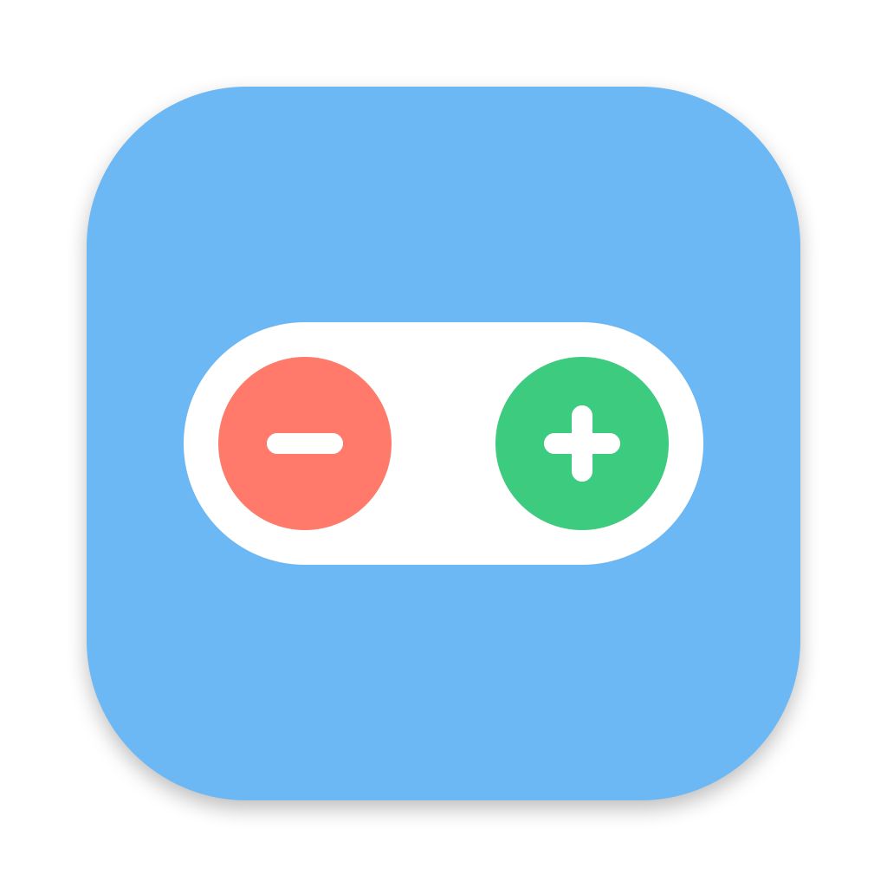

<p align="center">
  
</p>

<h1 align="center">ClickShift</h1>

<p align="center">
  Use a Zwift Click controller as a keyboard on your Mac.<br>
  A small, native macOS menu-bar app with no extra dependencies.
</p>

<p align="center">
  <a href="https://github.com/andriitrebukhin/ClickShift/actions/workflows/ci.yml"></a>
  <a href="https://github.com/andriitrebukhin/ClickShift/releases"></a>
</p>

---

ClickShift connects to a Zwift Click controller over Bluetooth LE and turns its buttons into keyboard key presses. It works with any app that takes keyboard input. The default bindings match **MyWhoosh**, so you can shift gears there right away.

> **Not affiliated with Zwift.** "Zwift" and "Zwift Click" are trademarks of Zwift, Inc. They're used here only to say which hardware this app works with.

## Features

- **Native and light:** Swift, SwiftUI and CoreBluetooth. Lives in the menu bar.
- **Per-button key mapping:** buttons behave like keyboard keys. The key goes down when you press and up when you let go. If you keep holding, it repeats every 350 ms.
- **See which button is which:** the matching row lights up while you press a button.
- **Reconnects on its own:** if the controller drops, ClickShift reconnects to it as soon as it's back in range.
- **Battery level** for each controller.
- **Offline:** no network access, no accounts, no telemetry.

## Supported controllers

| Controller | Status | Buttons |
|---|---|---|
| Zwift Click (v1) | ✅ | `+`, `−` |
| Zwift Click v2 | ✅ | `+`, `−`, D-pad (↑ ↓ ← →), A, B, Y, Z |

On Click v2, ClickShift connects to the left unit, which passes on the right unit's buttons. The right-side shift buttons, power-up button and paddle act as `+`. The left-side ones act as `−`.

## Download

Get the latest `ClickShift.dmg` from the [**Releases**](https://github.com/andriitrebukhin/ClickShift/releases/latest) page. Open it and drag **ClickShift** onto the **Applications** folder.

The app isn't notarized by Apple, so macOS blocks it the first time you open it:

1. Open ClickShift from Applications, then close the warning.
2. Go to *System Settings › Privacy & Security*, scroll down, and click **Open Anyway** next to the ClickShift message.
3. Confirm with **Open**. You only need to do this once.

To check that the download isn't corrupted, also download the `.sha256` file next to it and run:

```sh
shasum -a 256 -c ClickShift-<version>.dmg.sha256
```

Then follow [First run](#first-run).

## Requirements

- macOS 13 Ventura or later
- A Mac with Bluetooth LE
- To build from source: Xcode **or** just the Command Line Tools (`xcode-select --install`)

## Build from source

```sh
git clone https://github.com/andriitrebukhin/ClickShift.git
cd ClickShift
./build.sh
open build/ClickShift.app
```

`build.sh` compiles a release build with Swift Package Manager and puts it together as `build/ClickShift.app`. It also creates `build/ClickShift.dmg`, ready to attach to a GitHub release. To keep the app, move it to `/Applications`.

Run the tests with:

```sh
swift test
```

### Making a release

```sh
./release.sh 0.2.0             # build/release/ClickShift-0.2.0.dmg + .dmg.sha256
./release.sh 0.2.0 --publish   # also commits the version bump, tags v0.2.0, pushes,
                               # and creates the GitHub release with both files
```

Publishing needs the [GitHub CLI](https://cli.github.com) signed in with push access to the repo.

## First run

1. **Bluetooth:** allow access when macOS asks.
2. **Accessibility:** click **Grant…** in the ClickShift menu. Then turn ClickShift on in
   *System Settings › Privacy & Security › Accessibility*. macOS needs this before an app can send key presses to other apps.
3. **Wake the controller:** press any button on the Click. ClickShift finds it and connects automatically.

> **After every rebuild**, remove ClickShift from the Accessibility list and add it again.
> An ad-hoc signed app gets a new signature each time you build it, and macOS ties the permission to that signature.

## Usage

Click the bicycle icon in the menu bar to open ClickShift. There you can:

- **Change a key:** pick it next to the button. Pick **—** to turn a button off.
- **Pause key presses:** use the **Enabled** switch.
- **Restore the bindings below:** use **Reset to defaults**.

Key presses go to the app in focus, so keep the app you want to control active.

### Default bindings (MyWhoosh layout)

| Button | Key | In MyWhoosh |
|---|---|---|
| `+` | `K` | Shift up (harder) |
| `−` | `I` | Shift down (easier) |
| D-pad ↑ ↓ ← → | `↑` `↓` `←` `→` | Arrow keys (← / → steer) |
| A, B, Y, Z | `1`, `U`, `2`, `3` | — |

`K`, `I` and the arrow keys are MyWhoosh's keyboard controls. A, B, Y and Z send `1`, `U`, `2` and `3`.

## Troubleshooting

| Problem | What to try |
|---|---|
| Controller isn't found | Press a button to wake it. Close Zwift, Zwift Companion or any other app that might be connected to it, because a Click accepts only one connection. Update its firmware in Zwift Companion. |
| The log shows button presses but the app doesn't react | Check the Accessibility permission (see *First run*) and that the app you're controlling is in focus. |
| Click v2 stops responding after about a minute | Known Click v2 behaviour when it hasn't been paired with Zwift that day. Open the Zwift app, connect the Click there once, then quit Zwift and reconnect with ClickShift. |
| "Bluetooth permission denied" | *System Settings › Privacy & Security › Bluetooth*: turn on ClickShift. |

The latest 100 log lines are saved to `~/Library/Logs/ClickShift.log`, including each disconnect and how long the connection lasted. Please attach this file when you report an issue. It contains button events and connection status only.

<div align="center">

  ### ❤️ Support ClickShift

  Enjoying ClickShift? Consider buying me a coffee! ☕

  Your support helps me maintain the project and build new features.

  <br/>

  <a href="https://github.com/sponsors/andriitrebukhin">
    
  </a>

</div>

## License

[MIT](LICENSE)
